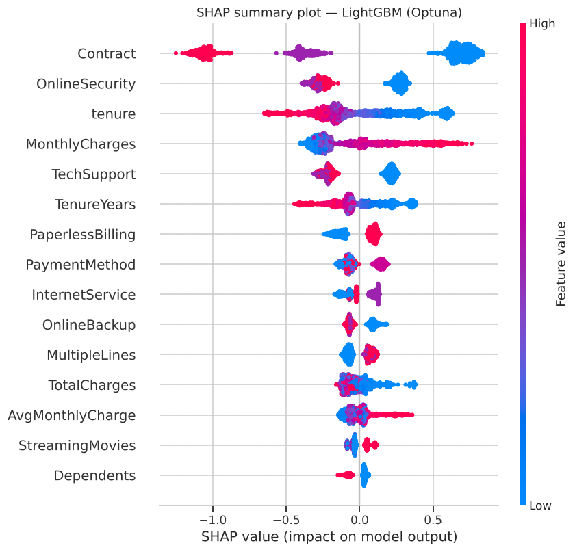

# 📉 Module 3 — Customer Churn: Ансамблевые методы

**Автор:** Боттер В.В., ПКТб-23-1
**Дата:** 2026-10-26
**Датасет:** [Telco Customer Churn](https://www.kaggle.com/datasets/blastchar/telco-customer-churn) — 7043 клиента, 26.5% ушедших

## 📊 Результаты (отложенная выборка 20%, 1409 клиентов, порог 0.5)

| Модель | Accuracy | Precision | Recall | F1 | ROC-AUC | CV ROC-AUC | Время |
|--------|----------|-----------|--------|-----|---------|-----------|-------|
| Random Forest | 0.760 | 0.535 | 0.743 | 0.622 | 0.839 | 0.843 | 0.65 сек |
| XGBoost | 0.763 | 0.542 | 0.695 | 0.609 | 0.828 | 0.834 | 0.18 сек |
| LightGBM | 0.759 | 0.533 | 0.751 | 0.624 | 0.838 | 0.840 | 0.15 сек |
| CatBoost | 0.749 | 0.519 | 0.743 | 0.611 | 0.841 | 0.838 | 0.44 сек |
| **LightGBM (Optuna)** | **0.742** | **0.509** | **0.810** | **0.625** | **0.850** | **0.850** | 0.3 сек |
| Stacking *(бонус)* | 0.804 | 0.646 | 0.580 | 0.611 | 0.848 | — | 9 сек |
| LightGBM + SMOTE *(бонус)* | 0.760 | 0.536 | 0.714 | 0.612 | 0.836 | — | 0.4 сек |

Ориентиры: одиночное дерево — ROC-AUC 0.743, логистическая регрессия — 0.847.

**Лучшая модель:** LightGBM после Optuna (50 испытаний TPE, 5-fold CV) → `models/best_model.pkl`.
Прирост к baseline LightGBM: +0.012 ROC-AUC на тесте, +0.010 на CV.
Лучшие параметры: `n_estimators=400, max_depth=3, learning_rate=0.0154, subsample=0.64, colsample_bytree=0.54, min_child_samples=45, reg_lambda=3.2`.

**Бонус-калибровка:** isotonic-калибровка сводит среднюю предсказанную вероятность с 0.41 к 0.266 (факт 0.265), Brier 0.162 → 0.134 без потери ROC-AUC.

## 🔍 Главные драйверы оттока (SHAP)
1. **Contract = Month-to-month** — отток 42.7% против 2.8% у двухлетнего контракта
2. **Короткий tenure** — в первые 6 месяцев уходит 52.9% клиентов
3. **Нет OnlineSecurity / TechSupport** — ≈ 42% против ≈ 15%
4. **Высокие MonthlyCharges** (> $70, обычно Fiber optic)
5. **PaymentMethod = Electronic check** — 45% оттока



## 🚀 Быстрый старт

```python
import joblib, json, requests
from io import BytesIO

BASE_URL = "https://raw.githubusercontent.com/uat0/ml-course-botter/main/module-3-churn"
model = joblib.load(BytesIO(requests.get(f"{BASE_URL}/models/best_model.pkl").content))
feature_cols = requests.get(f"{BASE_URL}/models/feature_cols.json").json()
encoders = joblib.load(BytesIO(requests.get(f"{BASE_URL}/models/label_encoders.pkl").content))
meta = requests.get(f"{BASE_URL}/models/preprocess_meta.json").json()
# полная предобработка «сырого» клиента — функция predict_churn() в notebook.ipynb (раздел 12)
```

## 🔧 Что сделано
- EDA: 9 графиков (целевая, tenure, MonthlyCharges, корреляции, отток по контракту / интернету / оплате / услугам / стажу)
- Пропуски: 11 «скрытых» пробелов в `TotalCharges` → медиана
- Feature Engineering: `TenureYears`, `AvgMonthlyCharge`, `IsNewClient`, `HasMultipleServices`
- Кодирование: `LabelEncoder` для 15 категориальных, `Churn` → 0/1; split 80/20 со `stratify`
- Модели: RF, XGBoost, LightGBM, CatBoost (+ дерево и LogReg как ориентиры), веса классов против дисбаланса
- Оценка: 5 метрик, 5-fold CV, матрицы ошибок, ROC-кривые
- Optuna (TPE, 50 испытаний), SHAP (summary, bar, waterfall, dependence)
- Бонус: Stacking, SMOTE, калибровка вероятностей и выбор порога

## 📁 Структура
- `notebook.ipynb` — полный отчёт (14 разделов)
- `data/` — `telco_churn.csv`, `churn_info.md`
- `models/` — `best_model.pkl` + 4 модели, `scaler.pkl`, `label_encoders.pkl`, `feature_cols.json`, `preprocess_meta.json`, `metrics.json`
- `examples/` — EDA, Feature Importance, ROC, матрицы ошибок, Optuna, SHAP (summary / waterfall / dependence)
- `requirements.txt`
